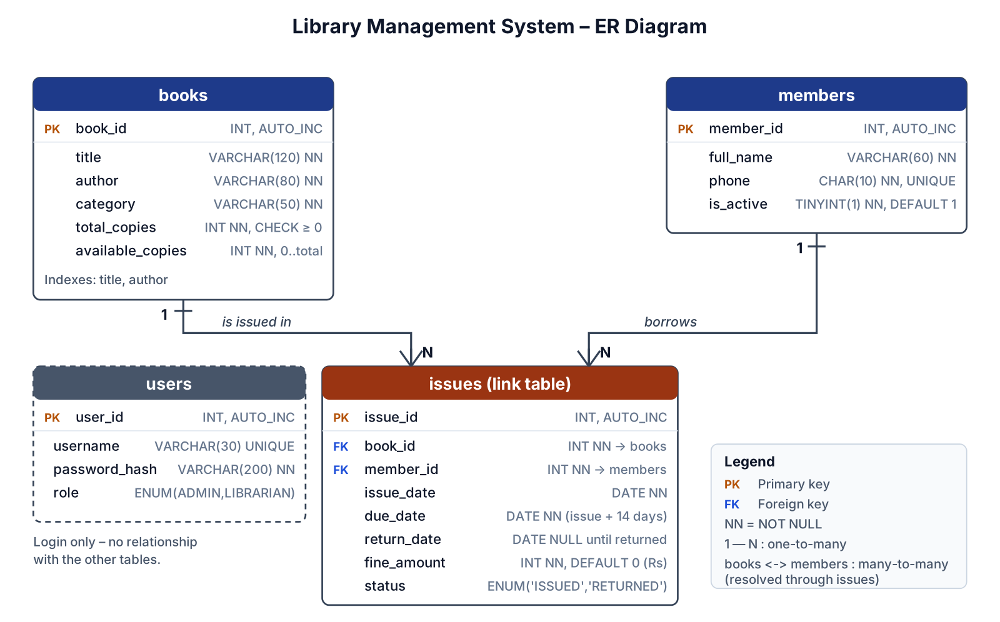
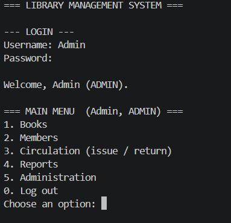
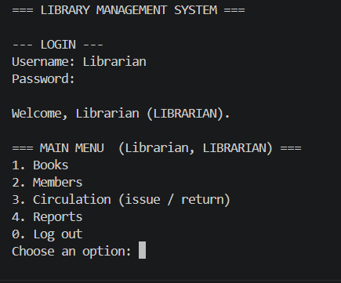
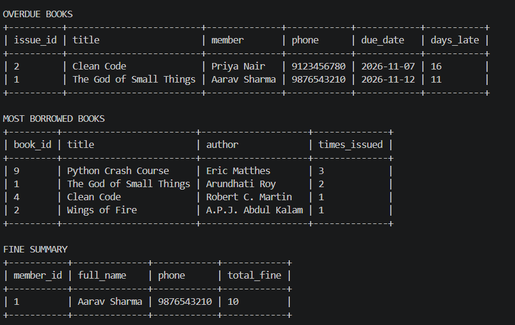
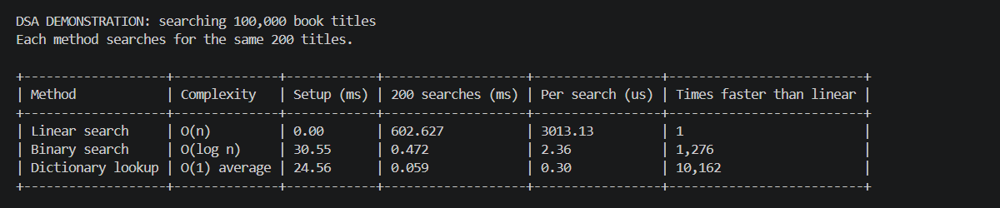
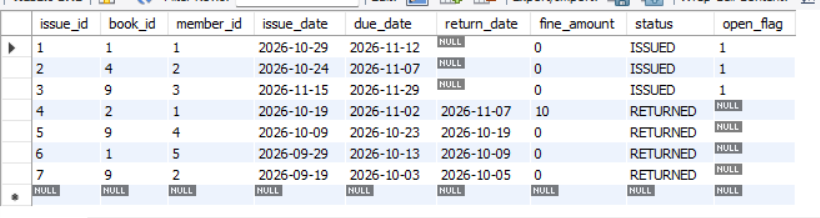
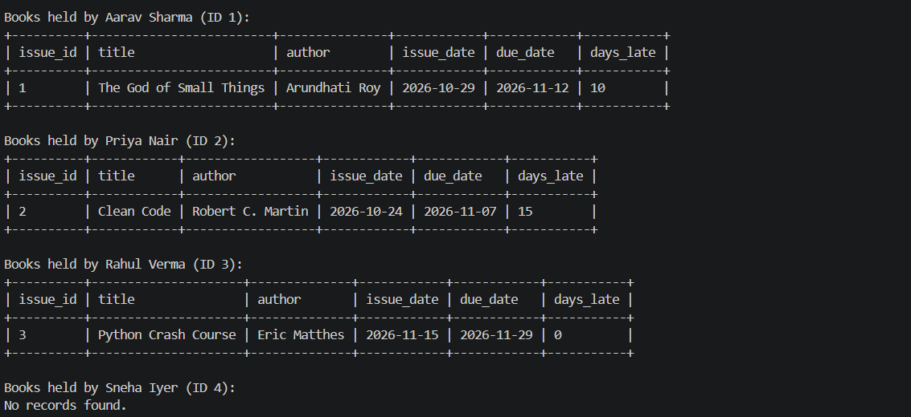
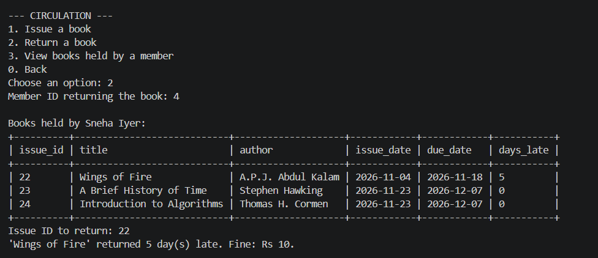
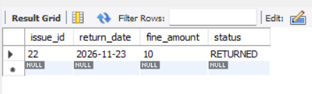
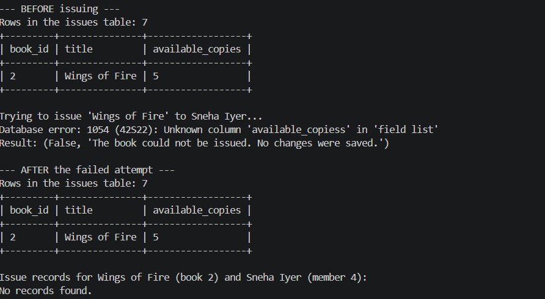

# Library Management System

A menu-driven Python and MySQL application that lets a library keep track of
its books and members, issue and return books, calculate fines automatically,
and produce reports.

## 1. Problem Statement

The library records borrowed books in a notebook. Staff cannot quickly see which
books are available, who is holding a book, which books are overdue, or how much
fine a member owes. Mistakes happen, for example the last copy of a book being
issued twice or a member borrowing more books than the rules allow. This project
replaces the notebook with a MySQL database and a command-line program that
checks every rule automatically, keeps the records correct, and produces reports
for the staff.

## 2. Features

| Module | Functions |
|---|---|
| Books | Add a book, view all books, search by title or author, update the number of copies |
| Members | Register a member, view members, search by name or phone, deactivate a member |
| Circulation | Issue a book, return a book (fine calculated automatically), view the books held by a member |
| Reports | Overdue books, most borrowed books, fine summary |
| Administration | Create new users (ADMIN only), run the DSA demonstration |

**Login and roles:** on the first run the program asks you to create the ADMIN
account. After that every user must log in. A LIBRARIAN cannot deactivate
members, create users, or view the fine summary.

### Business rules

1. The loan period is 14 days.
2. A member may hold at most 3 books at one time.
3. A book can be issued only when its available copies are above 0.
4. A member cannot hold two copies of the same book at the same time.
5. The fine is Rs 2 per day after the due date. It is calculated when the book is
   returned and saved in `fine_amount`.
6. Deactivated members cannot borrow books.
7. A book that has ever been issued cannot be deleted. The database refuses it
   (`ON DELETE RESTRICT`), and the program has no delete option.

## 3. Database

| Table | Purpose |
|---|---|
| `users` | Login accounts with a role (ADMIN or LIBRARIAN) and a hashed password. Not linked to the other tables. |
| `books` | The catalogue and the number of copies. |
| `members` | People who may borrow books. |
| `issues` | One row for each loan. It links books and members. |



One book has many issue records and one member has many issue records, so books
and members are many-to-many, resolved through `issues`. The database also
protects the data with `NOT NULL`, `UNIQUE`, `FOREIGN KEY`, `CHECK` and `ENUM`
constraints. Indexes on `books(title)`, `books(author)` and
`issues(member_id, status)` speed up searching.

## 4. Project Structure

| File | What it contains | Why it exists |
|---|---|---|
| `main.py` | First-run setup, login, menus and role checks | The only file the user runs. It contains no SQL. |
| `features.py` | Books, members, login, issue, return and loans | Business rules and the two transactions |
| `reports.py` | The three reports and the DSA demonstration | Each report is a single SQL query |
| `db.py` | Connection, `fetch_all`, `fetch_one`, `execute` | The only file that talks to MySQL |
| `helpers.py` | Input checks, password hashing, table printing | Reusable tools with no database code |
| `schema.sql` | Four tables, constraints, indexes, sample data | Builds the database |
| `.env.example` | Template of the connection settings | The real `.env` stays out of Git |
| `requirements.txt` | Python packages | One command installs them |

## 5. Setup and Run

Requirements: Python 3.10 or later, MySQL 8.0.16 or later, MySQL Workbench.

1. Clone the repository and open the folder.
2. Create and activate a virtual environment:
   ```
   python -m venv venv
   venv\Scripts\Activate.ps1
   ```
3. Install the packages:
   ```
   pip install -r requirements.txt
   ```
4. Copy `.env.example` to `.env` and put in your own MySQL user and password:
   ```
   copy .env.example .env
   ```
5. Create the database: open `schema.sql` in MySQL Workbench and run it.
   Warning: the script drops and recreates the four tables.
6. Start the program:
   ```
   python main.py
   ```
7. On the first run, create the ADMIN account when the program asks.

## 6. Screenshots

**Admin login and main menu**



**Librarian login: no Administration option**



**The three reports**



**The DSA timing table**



**The issues table in MySQL Workbench**



**Books currently held by members**



**A late return with a fine of Rs 10**



**The saved fine in the database**



## 7. Transactions and Rollback

Issuing and returning a book each change two tables, so each one runs as a
single transaction: either both changes are saved or neither is.

- **Issue:** insert a row in `issues`, then reduce `available_copies` with
  `WHERE book_id = %s AND available_copies > 0`. If that UPDATE changes 0 rows,
  the whole transaction is rolled back.
- **Return:** update the issue row (`return_date`, `status`, `fine_amount`), then
  increase `available_copies`. If anything fails, both changes are rolled back.

**Proof that rollback works:** I temporarily misspelled a column name in the
second step of issuing a book. The first step (the INSERT) ran, the second
failed, and the rollback removed the INSERT. The `issues` table had 7 rows
before and 7 rows after, and the available copies of the book stayed at 5.



## 8. Test Cases

| # | Test | Input | Expected result | Actual result | Pass/Fail |
|---|---|---|---|---|---|
| 1 | Wrong password | Username `Admin`, wrong password | Login refused | Incorrect username or password. | Pass |
| 2 | Issue to a deactivated member | Book 8, member 6 | Rejected | This member is deactivated and cannot borrow books. | Pass |
| 3 | Letters where an ID is expected | `abc` as the member ID | Asks again, no crash | Please enter a whole number (digits only). Then asked again; ID 4 gave "Books held by Sneha Iyer: No records found." | Pass |
| 4 | SQL injection text | Search `' or '1'='1` | No results, no error | No records found. | Pass |
| 5 | No copy available | Book 4 to member 5, then book 4 to member 4 | Second one is rejected | Issued 'Clean Code' to Karthik Raj. Due date: 2026-12-07. Then: No copy of 'Clean Code' is available right now. | Pass |
| 6 | Same book twice | Book 7 to member 5, twice | Second one is rejected | Issued 'Sapiens' to Karthik Raj. Due date: 2026-12-07. Then: This member already holds a copy of this book. | Pass |
| 7 | Fourth book | Books 2, 3 and 5, then book 6, all to member 4 | Fourth one is rejected | Books 2, 3 and 5 issued to Sneha Iyer (due 2026-12-07). Book 6: Sneha Iyer already holds 3 books, which is the maximum. | Pass |
| 8 | Return 5 days late | Loan made 5 days overdue, then returned | Fine Rs 10, copies +1 | 'Wings of Fire' returned 5 day(s) late. Fine: Rs 10. The database shows fine_amount 10 and status RETURNED. Available copies of Wings of Fire went from 4 to 5. | Pass |
| 9 | Return on time | Return a loan before its due date | No fine | 'A Brief History of Time' returned on time. No fine. | Pass |
| 10 | Duplicate phone number | Register phone 9876543210 | Rejected | This phone number is already registered (member ID 1). | Pass |
| 11 | Librarian restrictions | Log in as Librarian, type 4 in Members and 3 in Reports | Options hidden and refused | Deactivate option not shown; typing 4 gave: Only an ADMIN can deactivate members. Fine summary not shown; typing 3 gave: Only an ADMIN can view the fine summary. | Pass |
| 12 | Rollback on a forced error | Wrong column name in step 2 of issue | No new row in `issues` | 7 rows before and 7 after, copies still 5 | Pass |
| 13 | Update copies below the number issued | Book 4, new total 0 | Rejected | 1 copy/copies of 'Clean Code' are currently issued, so the total cannot be less than 1. | Pass |
| 14 | Update copies | Book 4, new total 3 | Available copies recalculated as new total minus copies issued | 'Clean Code' now has 3 copies (2 available). | Pass |

Screenshots of the tests are in the `screenshots` folder:
[1](screenshots/test01_wrong_password.png),
[2](screenshots/test02_deactivated_member.png),
[3](screenshots/test03_letters_as_id.png),
[4](screenshots/test04_sql_injection.png),
[5](screenshots/test05_no_copy.png),
[6](screenshots/test06_same_book_twice.png),
[7](screenshots/test07_fourth_book.png),
[8](screenshots/test08_late_return_fine.png),
[9](screenshots/test09_on_time_return.png),
[10](screenshots/test10_duplicate_phone.png),
[11](screenshots/test11_librarian_limits.png),
[12](screenshots/test12_rollback.png),
[13 and 14](screenshots/test13_14_update_copies.png).

## 9. Data Structures and Algorithms

I created a list of 100,000 book titles, sorted it, and searched for the same 200
titles with three methods, timing each with `time.perf_counter()`.

| Method | Complexity | Setup (ms) | 200 searches (ms) | Per search (us) | Times faster than linear |
|---|---|---|---|---|---|
| Linear search | O(n) | 0.00 | 602.627 | 3013.13 | 1 |
| Binary search | O(log n) | 30.55 | 0.472 | 2.36 | 1,276 |
| Dictionary lookup | O(1) average | 24.56 | 0.059 | 0.30 | 10,162 |

These are the numbers from one run on 23 November 2026. They change a little
each time, but the pattern stays the same.

- **Linear search** checks every title one by one, so the time grows with the
  size of the list.
- **Binary search** works only on sorted data and halves the search range at every
  step, so 100,000 titles need at most about 17 steps. Sorting is a one-time
  setup cost.
- **Dictionary lookup** goes straight to the title through its key. Building the
  dictionary is a one-time setup cost.

**Why a MySQL index gives a similar speed-up:** an index on `books(title)` keeps
the titles in a sorted structure (a B-tree). MySQL can then find a title by
repeatedly narrowing the range, like binary search, instead of reading every
row, like linear search.

## 10. Security

- Passwords are stored as salted PBKDF2-SHA256 hashes, never as plain text.
- Every query passes its values as parameters (`%s`), so typed text can never
  change the SQL.
- The database settings are kept in `.env`, which is excluded from Git.

## 11. Limitations and Future Improvements

- The program runs in the console only. A graphical or web interface would be
  easier for library staff.
- The rules are checked before the transaction starts. With several librarians
  using the program at once, row locking would make the checks stricter.
- A member who still holds books can be deactivated.
- Users cannot change their own password, and there is no password reset.
- Books and members cannot be edited after they are created, except for the
  number of copies and deactivation.
- Fines are calculated, but there is no record of whether they were paid.
- Tests were run by hand. Automated tests could be added.